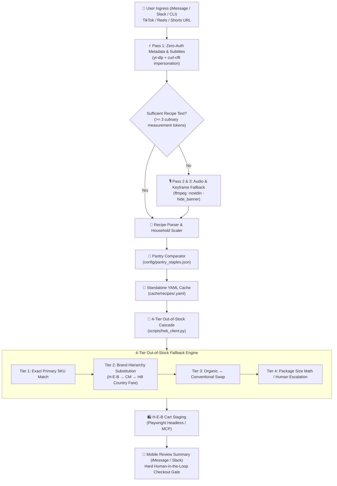

# 🛒 TikTok-2-HEB

> **Transform short-form cooking videos directly into scaled, pantry-audited H-E-B grocery carts.**

[](https://www.python.org/)
[](https://opensource.org/licenses/MIT)
[]()
[]()

**TikTok-2-HEB** is an autonomous, channel-agnostic AI agent skill and CLI toolkit that ingests recipe URLs (TikTok, Instagram Reels, YouTube Shorts), extracts ingredients and cooking techniques via a zero-auth multimodal pipeline, scales portions to match household demographics, checks kitchen pantry staples to avoid duplicate purchases, and stages candidate items directly into your local H-E-B curbside cart using a resilient 4-tier out-of-stock fallback cascade.

---

## 🏗️ System Architecture



---

## ✨ Key Capabilities

### 1. 🔓 Zero-Auth Multimodal Extractor
- **No API Keys or Logins Required:** Leverages `yt-dlp` paired with `curl-cffi` browser fingerprint impersonation (`chrome`) to scrape video descriptions, chapters, and auto-caption tracks anonymously.
- **3-Pass Resilience:**
  1. *Pass 1:* Instant metadata extraction + WebVTT / SRT auto-subtitles.
  2. *Pass 2:* Smart subtitle cleaner stripping timestamps, styling tags, and rolling caption duplicates.
  3. *Pass 3:* Heuristic fallback downloading high-efficiency MP3 audio or 0.5 fps video keyframes for silent or music-overlaid videos.

### 2. 🛡️ 4-Tier Out-of-Stock (OOS) Cascade (Anti-Cache-Poisoning)
When items are unavailable at your pinned H-E-B store, the fallback engine walks a deterministic brand hierarchy without corrupting original recipe preferences:
- **Tier 1 (Exact SKU):** Adds known primary SKU if in stock.
- **Tier 2 (Brand Hierarchy):** Matches equivalent product walking `H-E-B` → `H-E-B Organics` → `Central Market` → `Mi Tienda` → `Hill Country Fare` → `National Brand`.
- **Tier 3 (Organic ↔ Conventional Swap):** Fulfills organic orders with conventional or vice-versa when single-tier stockouts occur.
- **Tier 4 (Package Size Adjustment & Escalation):** Adjusts ordering quantities (e.g. 2x 8 oz bags if 16 oz is OOS) or flags category wipeouts as `⚠️ OUT OF STOCK (NEEDS HUMAN CALL)`.
- *Invariant:* Temporary substitutions **never** overwrite `primary_sku` in the recipe cache unless explicitly instructed by a human.

### 3. 👶 Household Scaler & Kid-Friendly Split
- Multiplies batch yield to match configured family portions (default `2.5` servings for 2 adults + 1 toddler).
- Enforces a minimum batch scaling factor (`0.65`) to prevent pan under-crowding and sauce reduction dry-out.
- **Spice Decoupling:** Identifies capsaicin elements (`sriracha`, `chili flakes`, `jalapeño`, `cayenne`, `gochujang`) and automatically splits cooking instructions—keeping the skillet base mild, plating the child's portion first, and dressing adult portions at the end.
- **Safety Prep:** Adds reminders to cube proteins into 1/2-inch bite-sized pieces.

### 4. 🧂 Pantry Deduplication
- Audits ingredients against a customizable 40+ canonical pantry database (`config/pantry_staples.json`).
- Automatically skips or tags common household staples (oils, vinegars, kosher salt, black pepper, soy sauce, cornstarch, baking essentials) so carts remain uncluttered.

### 5. 🔒 Hard Human-in-the-Loop (HITL) Gate
- Stages items into the cart and clips digital coupons.
- **Strict Invariant:** Never submits payment, selects delivery slots, or places final orders autonomously. Final review and one-tap checkout remain in the official **My H-E-B** mobile app.

---

## 🚀 Quickstart

### Prerequisites
- Python 3.11+
- `ffmpeg` (`brew install ffmpeg` on macOS or `sudo apt install ffmpeg` on Linux)
- [uv](https://github.com/astral-sh/uv) (recommended) or standard `pip`

### 1. Installation

```bash
# Clone the repository
git clone https://github.com/chorned/TikTok-2-HEB.git
cd TikTok-2-HEB

# Create virtual environment and install dependencies
uv venv --python 3.11 .venv
source .venv/bin/activate
uv pip install -r requirements.txt

# Install Playwright browser binaries
playwright install chromium
```

### 2. Configuration

```bash
# 1. Setup local environment
cp .env.example .env

# 2. Setup household & pantry configurations
cp config/household.example.yaml config/household.yaml
cp config/pantry_staples.example.json config/pantry_staples.json
```

Edit `.env` and `config/household.yaml` with your preferred H-E-B store (e.g. Store `390` for Austin - S. Congress / Oltorf):

```bash
HEB_STORE_ID=390
GEMINI_API_KEY=your_gemini_api_key_here
PLAYWRIGHT_HEADLESS=true
```

### 3. Pre-Flight Diagnostics Verification

Run the unified setup test suite to ensure all dependencies, system binaries, and configuration files are 100% operational:

```bash
python tests/test_skill_setup.py
```

Expected output:
```text
======================================================================
🚀 ALL TIKTOK-2-HEB PRE-FLIGHT CHECKS PASSED (100% OPERATIONAL)
======================================================================
Ran 7 tests in 1.8s
OK
```

---

## 💻 CLI Usage

### 1. Extract Recipe Media (Zero-Auth)
```bash
python scripts/extract_recipe_media.py "https://www.tiktok.com/@creator/video/73491829104"
```

Outputs clean metadata, parsed subtitles, and transcription tokens in JSON format.

### 2. Recipe Cache Operations
```bash
# Lookup an existing recipe by video ID, URL, or slug
python scripts/cache_manager.py lookup --query "73491829104"

# Save or update a structured recipe YAML file
python scripts/cache_manager.py save --file sample_recipe.yaml

# Permanently promote a user-selected substitution to primary SKU
python scripts/cache_manager.py promote-sku \
  --recipe-id "crispy-honey-garlic-salmon" \
  --ingredient-key "salmon_fillet" \
  --product-id "410294" \
  --name "Central Market Organics Atlantic Salmon" \
  --qty 1
```

### 3. Test H-E-B Catalog Search & OOS Cascade
```bash
# Search H-E-B store catalog
python scripts/heb_client.py "Atlantic Salmon" --store-id 390

# Test 4-Tier Out-of-Stock Fallback Cascade on an ingredient
python scripts/heb_client.py "Atlantic Salmon" --tier-test
```

---

## 📱 Mobile Review Template (iMessage / BlueBubbles)

When integrated with an agent (such as Hermes or Golem), reviews are formatted for crisp readability on mobile devices:

```text
🛒 H-E-B Cart Staged: Crispy Honey Garlic Salmon Bites
Scaled for 2 Adults + 1 Kid (~2.5 servings)

👶 Kid Prep Note:
• Hold the 1 tbsp sriracha out of the main skillet glaze. Plate the kid's portion first, then toss adult portions with sriracha.
• Cut kid's salmon into 1/2-inch bite-sized cubes.

✅ Added to H-E-B Cart (4 items):
• 1x H-E-B Fresh Atlantic Salmon Fillet (~1.25 lb) — $13.74
• 1x H-E-B Pure Clover Honey (12 oz) — $4.48
• 1x Fresh Green Onions (1 bunch) — $0.88
• 1x H-E-B Jasmine Rice (32 oz) — $2.74

🔄 Auto-Subbed (Out of Stock at Store):
• 2x H-E-B Broccoli Florets (10 oz bag) — $4.56
  (1 lb Organic Crowns were OOS; subbed 2x 10oz bags for this order only)

🎟️ Coupons Clipped:
• $1.00 off H-E-B Fresh Seafood Tray

🏠 Pantry Check (Skipped — reply to add):
• Soy sauce (3 tbsp), Garlic (4 cloves), Cornstarch (2 tbsp), Sesame oil (1 tsp)

📱 Next Step:
Reply if you want to add a pantry item (e.g. "add soy sauce") or swap a brand. Otherwise, open the My H-E-B app to review and tap checkout!
```

---

## 📂 Directory Layout

```text
TikTok-2-HEB/
├── .env.example                      # Template environment variables
├── .gitignore                        # Strict rules against credential & cache leaks
├── README.md                         # Public documentation & architecture guide
├── SKILL.md                          # Agent skill contract & deterministic workflow
├── requirements.txt                  # Pinned core dependencies
├── config/
│   ├── household.example.yaml        # Committed generic household configuration
│   ├── pantry_staples.example.json   # Committed 40-item standard pantry list
│   ├── household.yaml                # [GITIGNORED] Local active household profile
│   └── pantry_staples.json           # [GITIGNORED] Local pantry bypass list
├── scripts/
│   ├── extract_recipe_media.py       # 3-Pass zero-auth multimodal media extractor
│   ├── cache_manager.py              # Pydantic models, pantry comparator, YAML database
│   └── heb_client.py                 # H-E-B product search & 4-tier OOS fallback engine
├── cache/                            # [GITIGNORED] Local media & recipe database
│   ├── media/                        # Temporary audio tracks & extracted video keyframes
│   └── recipes/                      # Persistent recipe YAML database
└── tests/
    ├── test_core_modules.py          # Unit tests for extractor, cache, and cascade
    └── test_skill_setup.py           # Unified diagnostic & setup verification test
```

---

## 📄 License

Distributed under the MIT License. See `LICENSE` for details.

*Disclaimer: This project is an independent open-source tool and is not affiliated with, endorsed by, or sponsored by H-E-B, TikTok, ByteDance, or Instagram.*
