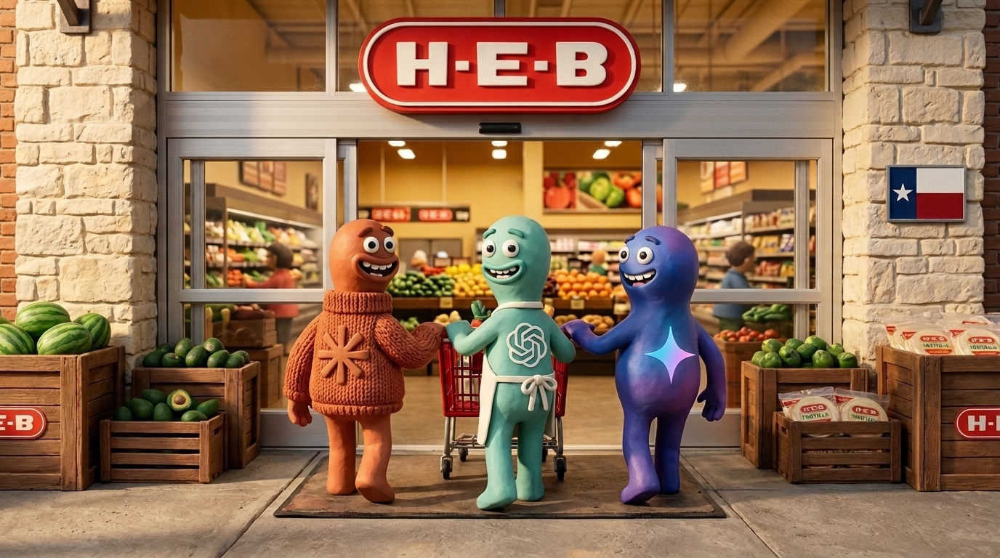

# 🛒 heb-mcp.skill



> **Your AI-powered H-E-B grocery assistant: add to carts using plain language or cooking videos (TikTok, Reels, YouTube Shorts), collaborate with your AI on the same live cart, auto-pick your favorite brands, clip coupons, and checkout in the My H-E-B app.**

[](https://www.python.org/)
[](https://opensource.org/licenses/MIT)
[]()

A lot of people have **Claude Code** (or another AI coding agent) included in their subscription, but haven't used it yet because terminal tools feel intimidating.

**heb-mcp.skill** *(formerly TikTok-2-HEB)* is built so **your AI does the technical work and you just do the eating.** You don't need to memorize terminal commands or edit code files—you just talk to Claude in plain language.

---

## 🙋 What You Do vs. 🤖 What Your AI Does

### 1. One-Time Setup (~3 Minutes)
* **What you do:** Make sure you're logged into [heb.com](https://www.heb.com) in your web browser (Safari or Chrome), open Claude Code, and paste the setup prompt below.
* **What your AI does:** Downloads this project, installs the tools, asks which H-E-B store you shop at (and whether you prefer Curbside Pickup or Delivery) plus how many people you're feeding, learns your favorite brands from your past orders, and sets up a daily background job so you stay logged in.

### 2. Everyday Grocery Runs (~10 Seconds)
* **What you do:** Ask for groceries in plain language (*"Add milk, eggs, and butter tortillas to my cart"*, *"Switch my store to Mueller H-E-B"*, *"Switch my cart to Curbside"*) **or** paste a TikTok, Instagram Reel, or YouTube Short recipe link (*"Put this dinner in my H-E-B cart"*).
* **What your AI does:**
  * If you sent a video, extracts the recipe automatically (no TikTok or Instagram login needed), scales portions for your family, and separates spicy steps if you have kids.
  * Intelligently suggests skipping pantry staples you likely already have at home (salt, pepper, olive oil, soy sauce).
  * Picks the exact H-E-B products and brands you usually buy, automatically swapping for an in-stock alternative if your store is out.
  * Clips matching digital coupons and adds everything directly into your shared live H-E-B cart.
* **What you do last:** Because you and your AI collaborate on the exact same H-E-B cart, you can add or tweak items yourself in the **My H-E-B** app—or ask your AI in plain language to swap or remove anything—and tap **Checkout** whenever you're ready. *(Your AI will **never** pay or place an order without you.)*

---

## 🚀 Getting Started (Copy & Paste)

Open **Claude Code** (or your favorite AI agent) and paste this message:

```text
Clone https://github.com/chorned/heb-mcp.skill.git and set it up for me.
Ask me for my preferred H-E-B store, whether I use Curbside or Delivery, and my household size, sync my preferred items from my past H-E-B orders, and set up a daily background job to refresh my H-E-B token so I stay logged in.
```

Claude will read [`SKILL.md`](SKILL.md) and walk you through the rest in plain language.

---

## 🔄 Stay Logged In Automatically (Recommended Daily Job)

While H-E-B's short-lived access tokens (`sat`) rotate every 30 minutes, this skill automatically refreshes them on the fly using your persistent session token (`sst`). To keep your underlying session warm so you never have to manually log back in before adding groceries, **have your AI set up a simple background job** that refreshes your token once every 24 hours.

You can just tell Claude Code:
> *"Set up a daily cronjob (or Scheduled Task on Windows) to refresh my H-E-B session token every 24 hours."*

Or if you prefer adding it yourself on macOS/Linux via `crontab -e`:
```cron
0 9 * * * cd /path/to/heb-mcp.skill && .venv/bin/python scripts/heb_client.py --harvest >/dev/null 2>&1
```

---

## ✨ Capabilities

* **Social Media Recipe Extraction:** Share recipes directly from **TikTok**, **Instagram Reels**, or **YouTube Shorts**. Extracts ingredients and measurements automatically from captions, audio, or video frames (zero login required), scales portions to fit your household, and splits out spicy steps for kids.
* **Full H-E-B Store & Collaborative Cart Control:** Anything you can do on `heb.com`, your AI can handle alongside you:
  * **Add & Remove Items (Shared Live Cart):** Add to and edit your live H-E-B cart using plain language or recipe links—you and your AI collaborate on the exact same cart in real time.
  * **Switch Delivery Method:** Toggle between **Curbside Pickup** and **Home Delivery**.
  * **Switch Preferred Store:** Set your home store during onboarding or switch to a different H-E-B location anytime.
  * **Apply Coupons:** Search and clip digital H-E-B coupons directly to your account.
  * **Smart Pantry Suggestions:** Intelligently identifies items likely already in your pantry (spices, oils, condiments) and suggests skipping them so you don't buy duplicates.
* **Preferred Brand & Recipe Caching:** Learns your favorite brands and package sizes from your past H-E-B orders and caches them locally alongside parsed recipes. Your preferred brands are always selected first, and temporary out-of-stock substitutions never overwrite your saved favorites unless you ask to make a swap permanent.

---

## 🔒 Privacy & Security

* **No Passwords Stored or Shared:** You log into [heb.com](https://www.heb.com) directly in your own web browser. Neither this tool nor your AI ever asks for, sees, or saves your H-E-B username or password.
* **Token-Only Access:** Once you log in, the tool only grabs the session token generated by your browser session to manage your cart and clip coupons.
* **OS-Level Encrypted Storage:** Your session token is protected by your operating system's default encrypted credential vault—such as **macOS Keychain** on Mac or **Windows Credential Manager / Data Protection API (DPAPI)** on Windows.
* **You Always Control Checkout:** Your AI can stage items and clip coupons, but it is strictly blocked from submitting payment or placing an order. You always review your cart and tap **Checkout** yourself in the **My H-E-B** app.

---

## 🙏 Acknowledgments & What We Added

Huge shout-out to [**`mgwalkerjr95/texas-grocery-mcp`**](https://github.com/mgwalkerjr95/texas-grocery-mcp), which pioneered the foundational H-E-B GraphQL operations (persisted queries for cart management, catalog search, and coupon clipping) and Imperva/`reese84` session handling.

On top of that foundation, **heb-mcp.skill** adds:
* **Social Media Recipe-to-Cart Pipeline:** A 3-pass zero-auth multimodal extractor (`yt-dlp` + `curl-cffi` + `ffmpeg`) that pulls ingredients and quantities from TikTok, Instagram Reels, and YouTube Shorts via captions, audio tracks, or video frames.
* **Preferred Brand & Past-Order Sync Engine:** Syncs your past H-E-B orders and *Buy It Again* history with time-decay ranking, manual brand pins, and automatic package-size math so your go-to products are always picked first.
* **5-Tier Out-of-Stock Substitution Cascade:** Automatically walks your preferred brand hierarchy (`H-E-B` → `H-E-B Organics` → `Central Market` → `Mi Tienda` → `Hill Country Fare` → `National Brand`) and organic/conventional swaps when items are out of stock, without overwriting your saved preferences.
* **Household Portion Scaling, Kid Prep Split & Smart Pantry Audit:** Scales recipe yields to match your family size, separates spicy prep steps for kids, and filters out staples already in your pantry.
* **Zero-Click Browser Session Harvesting & Auto-Refresh:** Reads active sessions directly from Safari and Chrome with automatic on-demand `sat` token renewal via `sst`.

---

## 📄 License

Distributed under the MIT License.

*Disclaimer: This project is an independent open-source tool and is not affiliated with, endorsed by, or sponsored by H-E-B, TikTok, ByteDance, or Instagram.*
